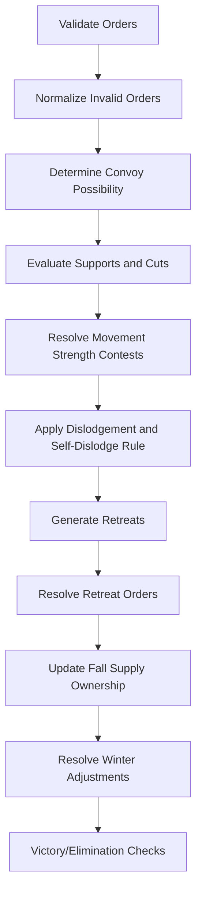

# DIPLOMACY_RULE_SPEC

## Status
- Version: 1.0
- Scope: Canonical rules for deterministic adjudication of classic 7-power Diplomacy.
- Non-goal: Runtime architecture, filesystem, messaging, or agent implementation.

## Canonical References
- [Official] Classic Diplomacy rules (Avalon Hill/Wizards printings; standard map and setup).
- [Implementation Decision] Use DATC (Diplomacy Adjudicator Test Cases) as a validation corpus for ambiguity-heavy cases.
- [Implementation Decision] Where official prose is ambiguous, this document defines a deterministic choice and marks it explicitly.

## Rule Labels
- `[Official]`: Standard game rule.
- `[Implementation Decision]`: Required engine behavior chosen by this project.

## Rule Invariants
These properties are the constitution of this rule engine and must hold regardless of internal implementation strategy.

- At most one active unit occupies a province.
- Orders resolve simultaneously.
- Adjudication is deterministic for identical inputs.
- Self-dislodgement is impossible.
- Supply ownership changes only at the Fall ownership checkpoint.
- Winter adjustments are derived solely from post-Fall supply ownership.
- Split coasts affect Fleet movement legality but not province occupancy capacity.
- Rule evaluation must not depend on iteration order except where this specification explicitly defines deterministic tie-break behavior.

## Overview
Diplomacy is a simultaneous-order strategy game for seven powers:
- Austria
- England
- France
- Germany
- Italy
- Russia
- Turkey

Game primitives:
- 34 supply centers (SCs)
- 75 provinces
- Units: Army (`A`) and Fleet (`F`)

Time model:
- `year` (integer)
- `season`: `spring`, `fall`, `winter`
- `phase`: `movement`, `retreat`, `adjustment`

Victory and outcomes:
- [Official] Solo victory: a power owns at least 18 SCs.
- [Implementation Decision] Draw is an outcome flag from game policy; adjudicator only reports board-derived eligibility state.
- [Official] Elimination: no units and no owned SCs.
- [Official] Survival: not eliminated at game end.

## Adjudication Semantics
This specification defines required adjudication semantics in terms of:
- required inputs
- required outputs
- required observable behavior

It intentionally does not prescribe one internal algorithm.

An implementation may use:
- dependency graphs
- fixed-point iteration
- recursive evaluation
- other deterministic approaches

provided observable results conform to this specification.

## Map Data Model
The map is data, not logic. Movement legality is computed from graph edges only.

### Map Schema (Normative Shape)
```json
{
  "schema_version": 1,
  "map_id": "standard",
  "version": 1,
  "powers": ["austria", "england", "france", "germany", "italy", "russia", "turkey"],
  "provinces": [
    {
      "id": "stp",
      "name": "St Petersburg",
      "abbr": "STP",
      "type": "coastal",
      "is_supply_center": true,
      "home_center_of": "russia",
      "occupiable_by": ["A", "F"],
      "coasts": ["stp_nc", "stp_sc"],
      "army_adjacency": ["fin", "lvn", "mos"],
      "fleet_adjacency": []
    }
  ],
  "coasts": [
    {
      "id": "stp_nc",
      "province": "stp",
      "fleet_adjacency": ["bar", "nwy"]
    }
  ],
  "convoy_passable_seas": ["adr", "aeg", "bal"],
  "initial_state": {
    "year": 1901,
    "season": "spring",
    "phase": "movement",
    "units": [],
    "supply_ownership": {}
  }
}
```

This schema defines required structure and constraints. It is not the canonical map instance.

## Canonical Map Artifact
`maps/standard.json` is the normative machine-readable source of truth for the standard map.

It MUST contain:
- provinces
- coasts
- army adjacency
- fleet adjacency
- convoy-passable sea provinces
- supply centers
- home centers
- initial setup

Requirements:
- `maps/standard.json` MUST include `schema_version`.
- Adjudication implementations MUST use `maps/standard.json` (not prose text) for map topology and setup.
- This document may include examples and validation checklists, but `maps/standard.json` is authoritative for province graph data.
- The rule specification owns map schema requirements.
- `maps/standard.json` owns canonical map data values.
- Implementations SHOULD NOT duplicate province metadata in independent hardcoded catalogs outside the canonical map artifact.

### Province Field Requirements
- `id`: stable lowercase ASCII id.
- `type`: `inland | coastal | sea`.
- `occupiable_by`:
  - inland: `["A"]`
  - sea: `["F"]`
  - coastal: `["A","F"]`
- `is_supply_center`: boolean.
- `home_center_of`: `null` or one power id.
- `army_adjacency`: province ids only.
- `fleet_adjacency`: province ids only for non-split coast movement.
- `coasts`: coast ids for split-coast provinces only.

### Province Catalog (Validation Checklist)
The standard map contains exactly 75 provinces. The canonical list is defined in `maps/standard.json`.

`adr, aeg, alb, ank, apu, arm, bal, bar, bel, ber, bla, boh, bre, bud, bul, bur, cly, con, den, eas, edi, eng, fin, gal, gas, gre, hel, hol, ion, iri, kie, lvn, lon, lvp, lyo, mao, mar, mos, mun, naf, nao, nap, nth, nwy, nwg, par, pic, pie, por, pru, rom, ruh, rum, ser, sev, sil, ska, smy, spa, stp, swe, syr, tri, tun, tus, tyr, tys, ukr, ven, vie, wal, war, wes, yor`

Split-coast provinces (additional coast nodes, not provinces):
- `bul_ec`, `bul_sc`
- `spa_nc`, `spa_sc`
- `stp_nc`, `stp_sc`

### Supply Centers (Validation Checklist)
`ank, bel, ber, bre, bud, bul, con, den, edi, gre, hol, kie, lon, lvp, mar, mos, mun, nap, nwy, par, por, rom, rum, ser, sev, smy, spa, stp, swe, tri, tun, ven, vie, war`

### Home Centers (Validation Checklist)
- Austria: `vie, bud, tri`
- England: `lon, edi, lvp`
- France: `par, bre, mar`
- Germany: `ber, kie, mun`
- Italy: `rom, ven, nap`
- Russia: `mos, war, sev, stp`
- Turkey: `ank, con, smy`

## Province Graph
Adjacency is represented by explicit graph relationships.

### Graph Types
- `army_adjacency`: legal Army moves.
- `fleet_adjacency`: legal Fleet moves (non-split case).
- `coast.fleet_adjacency`: legal Fleet moves when origin/destination uses a split coast.
- `convoy_passable_seas`: sea provinces that can carry convoy paths.

### Special Movement Regions
- [Official] Denmark, Kiel, Constantinople act as connectors between major sea/land regions by normal adjacency.
- [Implementation Decision] No province-specific hardcoded movement logic is allowed outside graph data.

### Coast Handling
- [Official] Split-coast provinces: Bulgaria, Spain, St Petersburg.
- [Implementation Decision] Fleet position in a split-coast province must include `coast_id`.
- [Implementation Decision] Army position in split-coast provinces stores province only.
- [Implementation Decision] A Fleet move involving split coasts is legal only if both origin and destination coast-level adjacency validate.

## Unit Model
```json
{
  "schema_version": 1,
  "unit_id": "u_001",
  "owner": "france",
  "type": "A",
  "province": "par",
  "coast": null,
  "status": "active",
  "dislodged_from": null,
  "must_retreat": false
}
```

Status values:
- `active`
- `dislodged`
- `destroyed`

Invariants:
- At most one active unit may occupy a province. Split coasts affect Fleet movement legality, not separate occupancy capacity.
- Dislodged units do not provide support, do not convoy, and do not block movement.

## Seasons
| Season | Required phases | Purpose |
|---|---|---|
| Spring | movement, optional retreat | movement and dislodgement handling |
| Fall | movement, optional retreat | movement plus SC capture checkpoint |
| Winter | adjustment | builds/disbands |

## Orders
All orders are structured JSON.

### Common Envelope
```json
{
  "schema_version": 1,
  "order_id": "o_1001",
  "power": "germany",
  "unit_ref": "u_010",
  "year": 1901,
  "season": "spring",
  "phase": "movement",
  "type": "MOVE",
  "payload": {}
}
```

### Movement Orders
- `HOLD`: `{ "at": "mun" }`
- `MOVE`: `{ "from": "ber", "to": "pru", "via_convoy": false }`
- `SUPPORT_HOLD`: `{ "from": "bur", "target": "par" }`
- `SUPPORT_MOVE`: `{ "from": "bur", "supported_from": "mar", "supported_to": "par" }`
- `CONVOY`: `{ "from": "eng", "army_from": "lon", "army_to": "bre" }`

### Retreat Order
- `RETREAT`: `{ "from": "bel", "to": "hol" }`

### Winter Adjustment Orders
- `BUILD`: `{ "unit_type": "F", "province": "sev", "coast": null }`
- `DISBAND`: `{ "unit_ref": "u_077" }`

## Resolution Pipeline
Adjudication is not purely linear in all positions. Dependencies can form between supports, support cuts, convoys, convoy disruption, head-to-head moves, and paradox cases.

[Implementation Decision] Engines MAY implement this using dependency graphs, iterative refinement, or fixed-point evaluation, as long as outputs are deterministic and conform to this spec.

The pipeline below is a conceptual overview of adjudication stages, not a claim that one forward pass is always sufficient.



Deterministic ordering:
- [Implementation Decision] Iterate powers, units, and orders in ascending lexical id order.
- [Implementation Decision] For tie-breaking in defaults, use deterministic lexical rules defined below.

## Movement Rules
- [Official] Orders resolve simultaneously.
- [Official] A move is legal only if destination is reachable by unit type (or by valid convoy for armies).
- [Official] Equal-strength competing attacks to same destination bounce.
- [Official] Units occupy destination only after full adjudication.

Illegal move examples:
- Fleet to inland province
- Army to sea without valid convoy
- Non-adjacent destination
- Split-coast mismatch

[Implementation Decision] Illegal movement orders are replaced by `HOLD`.

Head-to-head rule:
- [Official] Opposed swaps (`A->B` and `B->A`) require strict superiority; otherwise both fail.

## Support Rules
Support validity:
- Supporting unit must legally reach supported destination (for support move) or supported province (for support hold).
- Support references must match exact supported move tuple (`from`,`to`) or hold province.

Support cutting:
- [Official] Support is cut if supporter is attacked from any province except the province to which support is directed.
- [Official] Dislodged supporter gives no support.

Support not cut cases:
- Attack from the supported target province does not cut.
- [Implementation Decision] Orders invalidated before adjudication do not constitute attacks for cutting.

Self-dislodgement:
- [Official] A power cannot dislodge its own unit.
- [Implementation Decision] If an otherwise-successful attack would dislodge a same-power defender, treat that attack as failed for dislodgement.

## Convoys
Basic:
- [Official] Armies may move coast-to-coast through ordered Fleets in sea provinces.

Multiple routes:
- [Implementation Decision] Convoy succeeds if at least one ordered route remains valid.

Disruption:
- [Official] Dislodged convoying Fleet cannot convoy.

Project convoy rule:
> Convoy validity is determined independently of any support-cutting or dislodgement effects caused by the convoyed army itself.

[Implementation Decision] Required algorithm:
1. Build convoy graph from fleets issuing matching `CONVOY` orders.
2. Check route existence from army origin coast to destination coast using only those fleets.
3. Freeze `convoy_possible` for this army move before applying effects caused by that army.
4. Do not allow a convoyed army move to establish or preserve its own convoy route by cutting support or causing dislodgement that is required for that route's availability.

Rationale:
- Removes circular dependency and paradox instability.
- Keeps adjudication deterministic and DATC-aligned.

Convoy paradox fallback:
- [Implementation Decision] Use fixed-point iteration over convoy-dependent outcomes.
- [Implementation Decision] If no convergence, fail convoy-dependent paradox moves; keep independent moves resolved.

## Retreat Rules
Retreat options for each dislodged unit are generated from legal adjacent destinations that are:
- unoccupied after movement resolution
- not the successful attacker's origin province
- not a standoff province
- legal by unit type/coast

Illegal retreats:
- to occupied province
- to contested (standoff) province
- to attacker's origin
- by convoy

Destruction:
- No legal retreat or no valid retreat order -> destroyed.
- Two or more units retreating to same destination -> all those retreating units destroyed.

## Winter Adjustments
Supply ownership:
- [Official] Updated after Fall movement and Fall retreats.
- [Official] Ownership persists until another power occupies that SC in a later Fall checkpoint.

Adjustment count:
- `delta = owned_scs - active_units`
- `delta > 0`: up to `delta` builds
- `delta < 0`: exactly `abs(delta)` disbands

Build legality:
- Must be in owned, unoccupied home center.
- Fleet builds only in coastal home centers with valid coast assignment if needed.

Disband default:
- [Implementation Decision] If insufficient valid disband orders, auto-disband deterministically:
1. farthest (shortest-path distance) from any owned home center on unit-legal graph
2. then lexicographically largest province id
3. then lexicographically largest unit id

## Victory
- Solo win: any power owns >= 18 SCs at end of Fall/Winter ownership checkpoint.
- Draw: engine reports draw-eligible state only.
- Elimination: no units and no SCs.
- Survival: not eliminated at terminal result.

## Validation Rules
Validation layers:
1. Schema: required fields, enums, type correctness.
2. Referential: ids exist, unit belongs to power, coast belongs to province.
3. Phase: order type legal in current phase.
4. Positional: adjacency and terrain legality.
5. Semantic: support/convoy references match actual ordered unit actions.

Order classes:
- `malformed`: schema/type failure.
- `illegal`: violates phase or positional rule.
- `impossible`: references non-existent unit/province/coast.

Default handling:
- [Implementation Decision] Movement-phase malformed/illegal/impossible order -> substitute `HOLD`.
- [Implementation Decision] Retreat/adjustment malformed/illegal/impossible order -> reject; unresolved obligations cause destruction/auto-disband per rules.

## Canonical Data Models
### Province
```json
{
  "schema_version": 1,
  "id": "string",
  "name": "string",
  "abbr": "string",
  "type": "inland|coastal|sea",
  "is_supply_center": "boolean",
  "home_center_of": "power|null",
  "occupiable_by": ["A|F"],
  "army_adjacency": ["province_id"],
  "fleet_adjacency": ["province_id"],
  "coasts": ["coast_id"]
}
```

### Unit
```json
{
  "schema_version": 1,
  "unit_id": "string",
  "owner": "power",
  "type": "A|F",
  "province": "province_id",
  "coast": "coast_id|null",
  "status": "active|dislodged|destroyed",
  "must_retreat": "boolean"
}
```

### Board State
```json
{
  "schema_version": 1,
  "map_id": "string",
  "year": "integer",
  "season": "spring|fall|winter",
  "phase": "movement|retreat|adjustment",
  "units": ["Unit"],
  "supply_ownership": { "province_id": "power" },
  "home_centers": { "power": ["province_id"] }
}
```

### Order
```json
{
  "schema_version": 1,
  "order_id": "string",
  "power": "power",
  "unit_ref": "unit_id|null",
  "type": "MOVE|HOLD|SUPPORT_HOLD|SUPPORT_MOVE|CONVOY|RETREAT|BUILD|DISBAND",
  "payload": "object"
}
```

### Resolution
```json
{
  "schema_version": 1,
  "phase": "string",
  "validated_orders": [
    {
      "order_id": "string",
      "validation": "accepted|substituted|rejected",
      "effective_order": "Order"
    }
  ],
  "movement_outcomes": [
    {
      "unit_id": "string",
      "result": "moved|held|bounced|dislodged|destroyed",
      "from": "province_id|null",
      "to": "province_id|null"
    }
  ],
  "support_outcomes": [
    {
      "unit_id": "string",
      "status": "effective|cut|invalid"
    }
  ],
  "convoy_outcomes": [
    {
      "army_unit_id": "string",
      "status": "possible|impossible",
      "routes": [["province_id"]]
    }
  ]
}
```

### Resolution Artifact Invariants
Every `Resolution` artifact MUST guarantee:
- every submitted order has exactly one validation result
- every active unit has exactly one movement outcome for the resolved phase
- every support order has exactly one support outcome
- every convoy order has exactly one convoy outcome
- every dislodged unit either has legal retreat options or is marked destroyed by applicable phase rules
- the resulting board state is internally consistent with unit occupancy, status, and ownership invariants

### Retreat
```json
{
  "schema_version": 1,
  "unit_id": "string",
  "from": "province_id",
  "legal_destinations": ["province_or_coast_id"],
  "result": "retreated|destroyed|invalid"
}
```

### Supply Ownership
```json
{
  "schema_version": 1,
  "year": "integer",
  "owners": {
    "province_id": "power"
  }
}
```

### Adjustment State
```json
{
  "schema_version": 1,
  "year": "integer",
  "powers": [
    {
      "power": "string",
      "owned_scs": "integer",
      "active_units": "integer",
      "delta": "integer",
      "required_action": "build|disband|none"
    }
  ]
}
```

## Validation Philosophy
- Every rule in this specification should correspond to one or more automated tests.
- DATC provides interoperability and adjudication-consistency confidence.
- Local tests validate project-specific implementation decisions in this spec.
- Bug reports should be converted into regression tests whenever possible.

## Validation Test Suite
Each case is canonical and should map to an automated unit test fixture corpus.

[Implementation Decision] DATC should be imported as a fixture corpus and run alongside local canonical tests.

Each local test case should include:
- initial board state
- submitted orders
- expected validation results
- expected final board state
- expected retreat/build obligations (if any)

| ID | Case | Expected |
|---|---|---|
| T01 | Simple bounce (`A PAR->BUR`, `A MAR->BUR`) | both bounce |
| T02 | Three-way bounce | all fail to enter |
| T03 | Supported attack | defender dislodged |
| T04 | Support cut by third-party attack | support removed |
| T05 | Support not cut by target-province attack | support remains |
| T06 | Support hold under attack | defense includes support |
| T07 | Self-dislodgement attempt | own unit not dislodged |
| T08 | Basic convoy success | army arrives |
| T09 | Convoy fleet dislodged | convoy route broken |
| T10 | Multi-route convoy with one route broken | succeeds if one route survives |
| T11 | Convoy paradox | resolved by project convoy rule |
| T12 | Split-coast legality | coast-correct move succeeds only |
| T13 | Illegal terrain move | substituted to hold |
| T14 | Illegal retreat to standoff | retreat rejected |
| T15 | Retreat collision | all colliding retreats destroyed |
| T16 | Build legality (home center, occupied check) | invalid build rejected |
| T17 | Missing disbands | deterministic auto-disband |
| T18 | 18-SC threshold | solo win flagged |
| T19 | Elimination check | eliminated flagged |
| T20 | Malformed payload | phase policy applied |

## Out of Scope
This document does not define:
- filesystem structure or permissions
- game master orchestration lifecycle
- logging and artifact storage
- agent identity, memory, or messaging design
- negotiation mechanics outside rule-required order effects

## Future Rule Engines
This document specifies one rule engine for classic Diplomacy in the tournament framework. Future games should provide analogous rule specifications with equivalent rigor, without requiring architectural changes to the surrounding framework.

## Appendix A: Initial State (Spring 1901)
- Austria: `A vie`, `A bud`, `F tri`
- England: `F lon`, `F edi`, `A lvp`
- France: `A par`, `A mar`, `F bre`
- Germany: `A ber`, `A mun`, `F kie`
- Italy: `A rom`, `A ven`, `F nap`
- Russia: `A mos`, `A war`, `F sev`, `F stp_sc`
- Turkey: `A con`, `A smy`, `F ank`

## Appendix B: Determinism Requirements
- Sort all unordered collections before processing.
- Use stable lexical order for tie-breaks unless a rule explicitly defines strength comparison.
- Never use wall-clock data or randomization in adjudication.
- Serialize outputs with stable key ordering.

## Appendix C: Province Metadata Matrix (Exhaustive)
This appendix is an informative validation checklist. The normative machine-readable map data is `maps/standard.json`.

Format: `id,type,is_sc,home_center_of`

```text
adr,sea,false,null
aeg,sea,false,null
alb,coastal,false,null
ank,coastal,true,turkey
apu,coastal,false,null
arm,coastal,false,null
bal,sea,false,null
bar,sea,false,null
bel,coastal,true,null
ber,coastal,true,germany
bla,sea,false,null
bot,sea,false,null
boh,inland,false,null
bre,coastal,true,france
bud,inland,true,austria
bul,coastal,true,null
bur,inland,false,null
cly,coastal,false,null
con,coastal,true,turkey
den,coastal,true,null
eas,sea,false,null
edi,coastal,true,england
eng,sea,false,null
fin,coastal,false,null
gal,inland,false,null
gas,coastal,false,null
gre,coastal,true,null
hel,sea,false,null
hol,coastal,true,null
ion,sea,false,null
iri,sea,false,null
kie,coastal,true,germany
lvn,coastal,false,null
lon,coastal,true,england
lvp,coastal,true,england
lyo,sea,false,null
mao,sea,false,null
mar,coastal,true,france
mos,inland,true,russia
mun,inland,true,germany
naf,coastal,false,null
nao,sea,false,null
nap,coastal,true,italy
nth,sea,false,null
nwy,coastal,true,null
nwg,sea,false,null
par,inland,true,france
pic,coastal,false,null
pie,coastal,false,null
por,coastal,true,null
pru,coastal,false,null
rom,coastal,true,italy
ruh,inland,false,null
rum,coastal,true,null
ser,inland,true,null
sev,coastal,true,russia
sil,inland,false,null
ska,sea,false,null
smy,coastal,true,turkey
spa,coastal,true,null
stp,coastal,true,russia
swe,coastal,true,null
syr,coastal,false,null
tri,coastal,true,austria
tun,coastal,true,null
tus,coastal,false,null
tyr,inland,false,null
tys,sea,false,null
ukr,inland,false,null
ven,coastal,true,italy
vie,inland,true,austria
wal,coastal,false,null
war,inland,true,russia
wes,sea,false,null
yor,coastal,false,null
```
